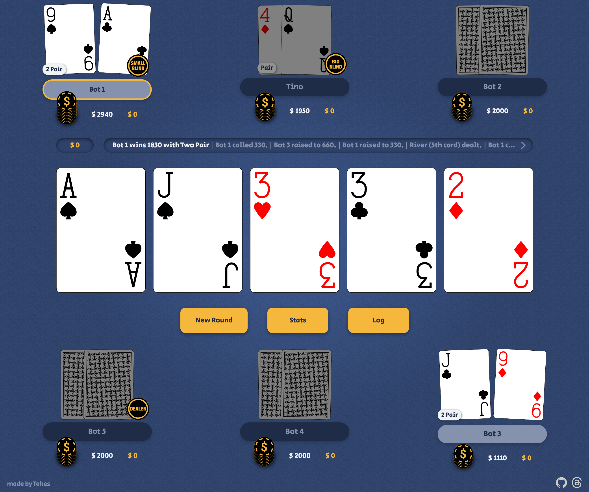

# Feltwise · 德州扑克训练桌



> 一个打开浏览器就能玩的德州扑克训练桌：和 Bot 对局、和朋友联机，在行动发生时理解底池赔率、位置和下注选择，并在牌局结束后回看自己的决定。

<p align="center">
  <a href="https://syy266313.github.io/poker-coach-lab/">立即开始游戏</a>
  ·
  <a href="https://github.com/syy266313/poker-coach-lab/issues">反馈问题</a>
  ·
  <a href="https://github.com/Tehes/poker">查看原项目</a>
</p>

## 这是什么

Feltwise 是一个面向练习和教学的浏览器德州扑克项目。它把牌桌、Bot、实时行动解释和牌局复盘放在同一个页面里，不需要注册账号，也不需要安装 App。

你可以把它当作三种东西：

- **Solo 训练桌**：一个人和 Bot 玩，边玩边看行动建议。
- **朋友联机桌**：朋友用自己的手机加入座位，私密底牌只显示在对应设备上。
- **复盘工具**：牌局保存在本机，结束后查看统计、关键行动和导出内容。

项目当前部署在 GitHub Pages：

**[https://syy266313.github.io/poker-coach-lab/](https://syy266313.github.io/poker-coach-lab/)**

## 为什么适合练习

牌桌会处理发牌、轮次、盲注、下注、边池和摊牌，让你把注意力放在决策上。轮到行动时，教练面板会结合当前牌面、位置、底池和需要跟注的筹码，给出简短解释。

它不会替你点击按钮，也不会假装给出“唯一正确答案”。建议把提示当作复盘线索，结合自己的范围判断、有效筹码和对手行为做决定。

## 功能一览

- 和 Bot 进行单人训练或观看 Bot 自动对局
- 支持 2 人到 6 人桌，空座位自动由 Bot 补齐
- 完整处理盲注、下注轮次、全下、边池和摊牌
- 盲注随手数逐步增加，避免牌局长期停滞
- 手机、平板和桌面端自适应布局
- 实时显示牌力、胜率、底池赔率和行动解释
- 提供新手、进阶和高手三档教练模式
- 记录 VPIP、PFR、激进度、摊牌胜率等训练数据
- Career 页面查看生涯统计、牌局列表和收藏记录
- 支持导出 Markdown / JSON，方便交给 AI 或自己整理
- 人类座位生成 QR Code 和加入链接
- 联机时支持私密底牌视图和远程行动
- Bot-only 牌局支持快速推进
- 支持本地保存未完成的 Solo 牌局

## 三种玩法

### Solo vs Bots

在共享设备上输入一个玩家名字，其他座位留空，点击 `Start`。空座位会自动补入 Bot，适合快速练习起手牌、位置和下注尺寸。

### 朋友联机

至少有两名真人玩家时，牌桌会生成联机牌局。每个真人座位都提供 QR Code 和链接：

1. 主设备打开牌桌并输入玩家名字。
2. 朋友扫描自己座位的 QR Code，或打开对应链接。
3. 每个人在自己的设备上查看私密底牌。
4. 轮到行动的玩家可以直接从自己的设备操作。

联机同步是尽力而为的。后端不可用时，牌桌仍可继续在主设备上运行；已加入设备会退化为只读的伴侣视图。

### Spectator / TV Poker

不输入真人名字时，整桌由 Bot 自动运行。适合展示牌局流程、观察 Bot 行为，或把设备当作一张自动播放的扑克桌。

## 本地数据与隐私

- 不需要注册账号。
- Solo 牌局和 Career 数据保存在当前浏览器的本机存储中。
- 本地牌局不会自动上传到云端。
- 只有多人联机牌局会按需使用同步后端。
- 导出 Markdown / JSON 只在你点击导出时生成。
- QR Code 会携带加入所需的牌局信息；不要把私人牌局链接随意公开。
- 远程座位链接目前是轻量、基于信任的链接，没有独立的座位令牌或登录校验。

## 快速开始

直接打开：

[https://syy266313.github.io/poker-coach-lab/](https://syy266313.github.io/poker-coach-lab/)

然后：

1. 给一个座位输入名字。
2. 其他座位留空，让 Bot 自动补位。
3. 点击 `Start`。
4. 轮到你时，根据牌面、位置、底池赔率和教练提示做决定。
5. 打完几手后，打开“生涯数据”查看统计和牌局复盘。

项目也可以作为静态站点运行。构建后的 `dist/` 目录就是可部署内容。

## 技术结构

- **Vanilla HTML / CSS / JavaScript**：不依赖前端框架。
- **浏览器端牌局引擎**：负责状态、下注流程、Bot 行动和摊牌。
- **Career Store**：保存本地牌局、统计和导出数据。
- **IndexedDB hand ID allocator**：为牌局生成协调 ID；异常时会明确降级为非协调 ID。
- **Service Worker**：为静态资源提供缓存能力。
- **可选 Deno 同步后端**：为多人牌局提供状态和行动同步。
- **qr-creator**：生成玩家加入 QR Code。
- **pokersolver**：完成摊牌牌力比较。

## Bot 怎么做决定

Bot 不是固定的“强牌下注、弱牌弃牌”脚本，也不是求解器。它使用一组面向训练赛的启发式规则，综合考虑：

- M-ratio 和剩余筹码压力
- 位置、有效筹码和盲注水平
- 底池赔率与下注尺寸
- 私人牌力相对公共牌面的真实优势
- 牌面湿润程度、听牌和摊牌价值
- 对手的入池率、激进度和摊牌表现
- 翻前开池、3-bet、挤压和短筹码全下压力

目标是让对局具有合理的比赛节奏和可观察的决策线，帮助你发现自己的重复问题，而不是宣称 Bot 代表 solver 的最优解。

## 本地开发

环境要求：

- [Deno](https://deno.com/)
- [Node.js](https://nodejs.org/)（用于构建 dist）
- 如需运行浏览器 speedmode，还需要本机可用的 Chromium / Chrome

克隆项目并进入目录：

```sh
git clone https://github.com/syy266313/poker-coach-lab.git
cd poker-coach-lab
```

构建最新静态产物：

```sh
node tools/build.mjs
```

构建结果会写入 `dist/`。GitHub Pages 的 Actions 会在推送到 `main` 后自动构建并发布该目录。

## 测试与批量运行

牌局引擎和契约测试：

```sh
deno check js/app.js js/careerPage.js
deno test js/careerContract.test.js js/handId.test.js js/gameEngine.test.js js/bot.test.js
```

运行无浏览器的 Bot 牌局批量测试：

```sh
deno task engine:batch
deno task engine:batch:500
deno task engine:batch:1000
```

运行带牌力诊断的批量测试：

```sh
deno task engine:batch:equity
```

运行浏览器端 smoke test：

```sh
deno task speedmode
deno task speedmode:10
```

引擎批量运行适合检查 Bot、下注规则、边池和比赛流程；speedmode 适合检查页面启动、DOM、计时器、通知和浏览器上下文。修改浏览器编排或界面副作用后，优先运行 speedmode。

## 项目约定

这是一个修改版的个人训练项目。修改牌局逻辑时，请先阅读 `agents.md`，并遵守模块边界：

- `js/gameEngine.js`：核心牌局规则。
- `js/bot.js`：Bot 决策逻辑。
- `js/shared/`：可复用的行动、同步、渲染和数据契约模块。
- `js/careerPage.js` / `js/careerStore.js`：Career 页面和本地复盘数据。
- `tools/`：构建和发布辅助脚本。

改动完成后运行相关 `deno check`、测试和 `node tools/build.mjs`，确认生成的 `dist/` 与源码一致。

## 已知边界

- 多人同步依赖后端，网络或后端异常时会降级。
- Solo 存档只存在当前浏览器和设备中。
- 远程座位链接目前没有登录、座位令牌和权限校验。
- 盲注递增规则目前不可配置。
- 教练提示用于学习和复盘，不构成财务或赌博建议。

## 来源与许可

本项目基于 [Poker by Tehes](https://github.com/Tehes/poker) 修改，属于 source-available 的非官方版本，不是原项目的官方发行版。

允许个人、教育和非商业用途下查看、修改和使用代码。公开再发布修改版时，请：

- 保留原项目链接和署名；
- 在应用和项目说明中明确标注这是修改版、非官方版本；
- 不将修改版包装成原项目或官方产品；
- 未经书面许可，不进行商业使用、付费托管或转售。

## 致谢

- [Tehes/poker](https://github.com/Tehes/poker)：原始牌桌项目
- [pokersolver](https://github.com/goldfire/pokersolver)：牌力评估
- [qr-creator](https://github.com/nimiq/qr-creator)：QR Code 生成

如果你发现牌局规则、页面布局、同步流程或复盘数据存在问题，欢迎通过 [Issues](https://github.com/syy266313/poker-coach-lab/issues) 提交可复现步骤。